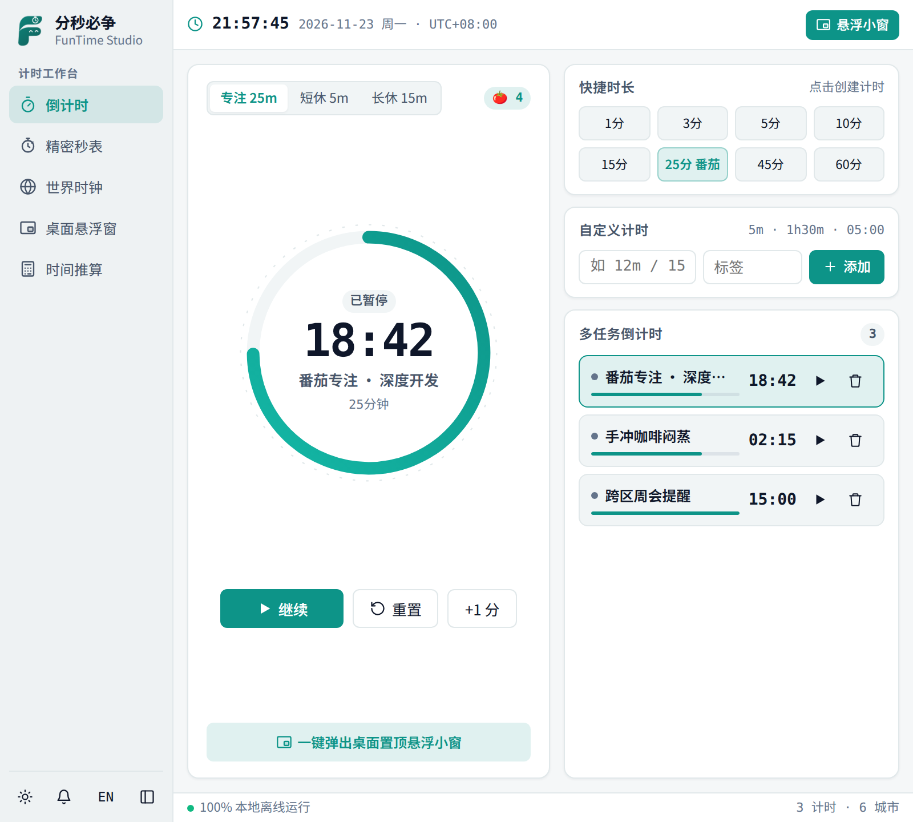
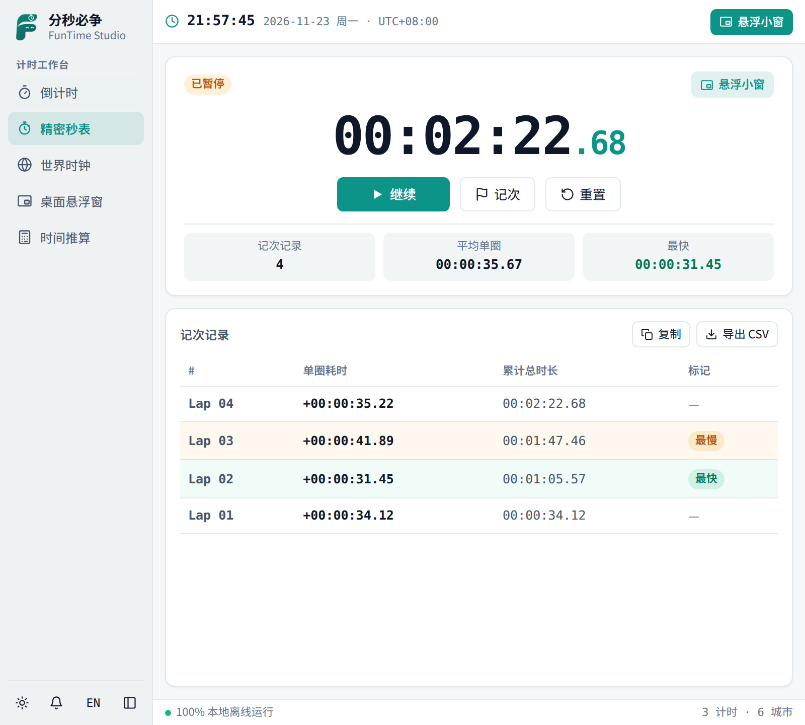
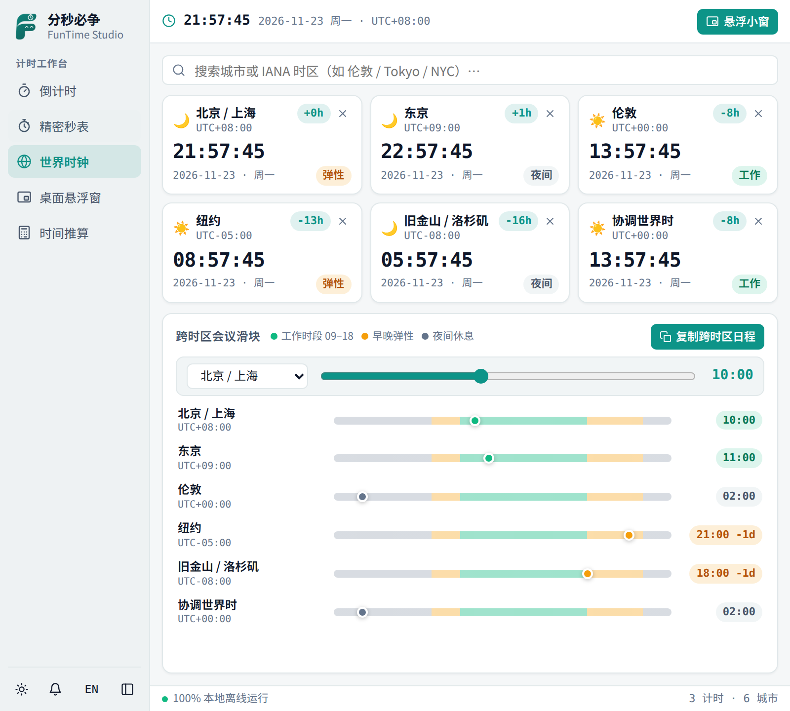
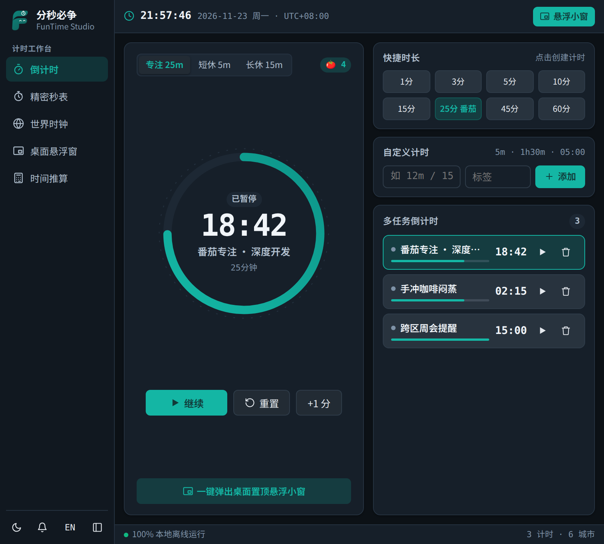

# 分秒必争 · FunTime

<p align="center">
  
</p>

**完全离线**的 uTools 精密计时与世界时钟工作台：集多任务倒计时、番茄专注钟、毫秒级秒表记次、28 城世界时钟与跨时区会议滑块、**桌面置顶悬浮小窗**、日期间隔与偏移推算以及 uTools AI / MCP 工具于一体。

## 功能预览

| 倒计时与番茄专注 | 精密秒表与记次统计 |
| :---: | :---: |
|  |  |

| 世界时钟与跨时区会议滑块 | 桌面置顶悬浮小窗控制中心 |
| :---: | :---: |
|  |  |

| 深色模式 · 精密计时工作台 |
| :---: |
|  |

## 核心特性

- **多任务倒计时 & 番茄钟**：圆形 SVG 进度环与等宽数字显示，支持多条倒计时同时独立运行、番茄模式一键切换（`专注 25m` / `短休 5m` / `长休 15m`）、自然时长输入（`5m`、`1h30m`、`90s`、`05:00`、`25分钟`）、uTools 主搜索框正则快启、Web Audio 离线提示音与系统通知。
- **精密秒表**：无漂移毫秒级计时（`HH:MM:SS.cc`），支持快捷记次（点击按钮或按 `L` 键）、自动高亮最快 / 最慢单圈、平均单圈统计，以及一键复制或导出 CSV。
- **世界时钟 & 跨时区会议滑块**：内置 28 个全球核心城市 IANA 时区离线库（自动处理夏令时），实时展示昼夜标识、本地时差与 UTC 偏移；拖动 24 小时跨时区滑块即可同时对比所有城市工作时段，一键复制跨时区会议日程。
- **桌面置顶悬浮小窗（Always-on-Top）**：
  - 在 uTools 内点击任意位置的 **悬浮小窗** 按钮或搜索「悬浮时钟 / 桌面悬浮 / 小窗计时」，即可通过 `utools.createBrowserWindow('dist/widget.html', ...)` 弹出独立置顶小窗；
  - 支持 **标准卡片 / 迷你胶囊** 两种形态、**深色玻璃 / 浅色磨砂** 材质、`65%–100%` 透明度调节，以及 `当前倒计时` / `精密秒表` / `数字时钟` / `世界双时区` 四种实时模式；
  - 主窗口与悬浮窗通过 `BroadcastChannel` + `localStorage` 实时双向同步，可在悬浮窗直接拖拽与控制开始 / 暂停 / 重置 / 切换模式。
- **时间推算**：支持双日期精确间隔拆解（天 / 时 / 分 / 秒、总小时与总分钟）以及基准日期加减推算（同时输出本地时间、ISO 8601、Unix 秒 / 毫秒时间戳）。

## uTools AI / MCP 工具

插件在启动时自动通过 `utools.registerTool` 注册以下三个纯本地离线工具，供 uTools AI 或开启 MCP 后的第三方 Agent 调用（仅做本地计算，不访问网络，也不读取私有隐私数据）：

| 工具名 | 说明 |
| --- | --- |
| `world_clock_now` | 获取一个或多个 IANA 时区或城市的当前本地时间、日期、UTC 偏移与昼夜状态 |
| `convert_timezone` | 在源时区与目标 IANA 时区之间转换指定日期时间，自动处理夏令时与跨日 |
| `calculate_time_diff` | 计算两个时间戳/日期的精确间隔，或在基准时间上加减偏移量推算目标时间 |

## 本地开发与验证

```bash
pnpm install
sh build.sh
```

运行测试与自动截图检查：

```bash
pnpm test
node scripts/screenshots.mjs
```

打包 `.upxs` 发布说明请参考 [docs/release-upxs.md](docs/release-upxs.md)。

## 开源协议

[MIT](LICENSE)
